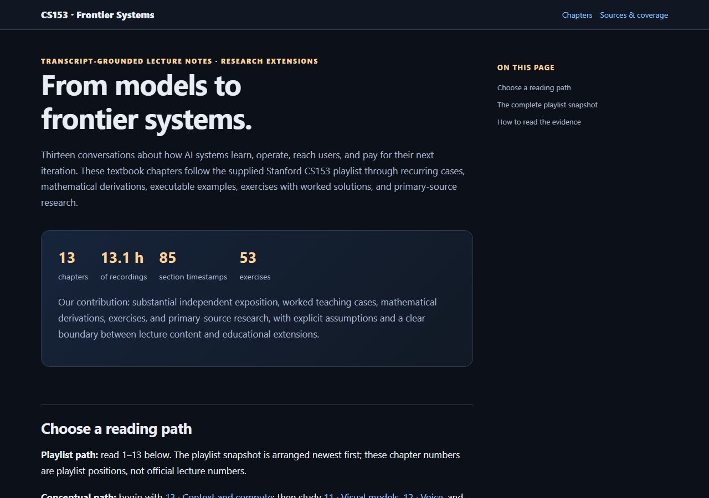

# Stanford CS153: Frontier Systems

### Independent transcript-grounded textbook and study companion

**[Read the live textbook](https://az9713.github.io/cs153-frontier-systems-notes/)** · **[Sources and research bibliography](https://az9713.github.io/cs153-frontier-systems-notes/sources.html)** · **[Original YouTube playlist](https://www.youtube.com/playlist?list=PLoROMvodv4rN447WKQ5oz_YdYbS74M5IA)**

[](https://az9713.github.io/cs153-frontier-systems-notes/)

This study companion is based on **[Stanford University's CS 153: Frontier Systems, Spring 2026](https://cs153.stanford.edu/)**, taught by **Anjney Midha and Michael Abbott**. The course examines the AI stack, from energy and silicon through models, products, organizations, and deployment. Stanford and the original speakers deserve credit for the course, conversations, and source recordings.

The notes cover **all 13 recordings in the supplied playlist snapshot of 25 September 2026**. The starting source video is **[Building the Frontier Ecosystem, with Satya Nadella](https://www.youtube.com/watch?v=d0Pfu6B7gIM&list=PLoROMvodv4rN447WKQ5oz_YdYbS74M5IA)**. The table below links every chapter to its original recording. Chapter numbers follow the snapshot's newest-first playlist order; they are not official course lecture numbers or a claim to cover every class in the Stanford syllabus.

## Our contribution beyond the transcripts

Our contribution is the independent educational development and presentation of the material: approximately **46,200 words**, **85 timestamped main sections**, **53 exercises with worked solutions**, and **15 executable Python examples** across 13 chapters.

- **Mathematical development:** definitions, notation, assumptions, derivations, and explicit limits for models of scaling, reliability, infrastructure, economics, experimentation, generative modeling, and voice systems.
- **Worked teaching cases:** recurring hypothetical scenarios, numerical calculations, counterexamples, and sensitivity analyses that let readers test the ideas. These constructions are ours and are identified as extensions.
- **Researched extensions:** primary papers, official technical documentation, institutional sources, and relevant corrections are integrated alongside the claims they support. The consolidated bibliography contains 47 distinct reference URLs.
- **Practice and verification:** exercises with developed solutions and runnable Python examples with assertions. The examples use the Python standard library and require no model service, API key, or paid inference.
- **A navigable textbook:** timestamped links back to the recordings, a conceptual reading path, editable Markdown, mobile navigation, collapsible solutions, copyable code, print styles, and bundled MathJax for offline equations.

The added equations, examples, research, and exercises should not be attributed to a speaker merely because they appear under a timestamped heading. Speaker opinions and predictions remain attributed claims. These are independent study notes, **not official Stanford materials and not endorsed by Stanford or the speakers**.

## Read the chapters as live web pages

GitHub displays source HTML in the repository. The **Read** links below open the rendered pages on GitHub Pages, with equations and interactive controls enabled.

| Chapter | Topic and speaker | Live notes | Source recording |
| --- | --- | --- | --- |
| 01 | Building the frontier ecosystem — Satya Nadella | [Read](https://az9713.github.io/cs153-frontier-systems-notes/lecture-01.html) | [YouTube](https://www.youtube.com/watch?v=d0Pfu6B7gIM) |
| 02 | Scale, AGI, and the future — Sam Altman | [Read](https://az9713.github.io/cs153-frontier-systems-notes/lecture-02.html) | [YouTube](https://www.youtube.com/watch?v=F_7M4Hc-usM) |
| 03 | Resilience — Joe Sullivan | [Read](https://az9713.github.io/cs153-frontier-systems-notes/lecture-03.html) | [YouTube](https://www.youtube.com/watch?v=g50FHC-PzK8) |
| 04 | Delivering value per gigawatt — Amin Vahdat | [Read](https://az9713.github.io/cs153-frontier-systems-notes/lecture-04.html) | [YouTube](https://www.youtube.com/watch?v=VeTqsCpcDgg) |
| 05 | The AI-native company — Garry Tan and Diana Hu | [Read](https://az9713.github.io/cs153-frontier-systems-notes/lecture-05.html) | [YouTube](https://www.youtube.com/watch?v=Lri2LNYtERM) |
| 06 | Compute and co-design — Jensen Huang | [Read](https://az9713.github.io/cs153-frontier-systems-notes/lecture-06.html) | [YouTube](https://www.youtube.com/watch?v=tsQB0n0YV3k) |
| 07 | Energy — Scott Nolan | [Read](https://az9713.github.io/cs153-frontier-systems-notes/lecture-07.html) | [YouTube](https://www.youtube.com/watch?v=wisccQYTRQc) |
| 08 | Venture capital — Ben Horowitz | [Read](https://az9713.github.io/cs153-frontier-systems-notes/lecture-08.html) | [YouTube](https://www.youtube.com/watch?v=B8NvdfssGac) |
| 09 | Product management in the AI era — Nikhyl Singhal | [Read](https://az9713.github.io/cs153-frontier-systems-notes/lecture-09.html) | [YouTube](https://www.youtube.com/watch?v=BQrJ4lHAjhc) |
| 10 | Unified intelligence — Amit Jain | [Read](https://az9713.github.io/cs153-frontier-systems-notes/lecture-10.html) | [YouTube](https://www.youtube.com/watch?v=6nUl_w5W9Wk) |
| 11 | Visual intelligence — Andreas Blattmann | [Read](https://az9713.github.io/cs153-frontier-systems-notes/lecture-11.html) | [YouTube](https://www.youtube.com/watch?v=CBaLU0dDEY8) |
| 12 | Voice systems — Mati Staniszewski | [Read](https://az9713.github.io/cs153-frontier-systems-notes/lecture-12.html) | [YouTube](https://www.youtube.com/watch?v=vfF011ko89o) |
| 13 | Frontier systems — Anjney Midha | [Read](https://az9713.github.io/cs153-frontier-systems-notes/lecture-13.html) | [YouTube](https://www.youtube.com/watch?v=O5PfU_uDhS0) |

For a conceptual progression, start with chapter 13; continue through 11, 12, and 10 for models and systems; 4, 6, and 7 for infrastructure; 5, 8, and 9 for building and organizations; then 1, 2, and 3 for ecosystem, scaling, and resilience. Basic linear algebra, probability, and calculus are useful prerequisites.

## Source provenance and limits

The full available English transcript text was read for each recording. Ten caption sources were retrieved directly from YouTube. Chapters 9, 11, and 13 use the explicitly credited [c7b transcript archive](https://github.com/c7b/CS153-Frontier-Systems-Transcripts). Manual-versus-automatic metadata was not retained for the directly retrieved tracks; the archive describes automatic captions with light formatting. Technical caption errors remain possible.

Timestamps locate relevant lecture topics. Slides and visual demonstrations were not independently inspected continuously. Personal anecdotes and repetitive discussion are compressed. Private commercial figures and forecasts are not treated as independently established facts. The earliest listed recording refers to an earlier class outside this snapshot.

The [source map](https://az9713.github.io/cs153-frontier-systems-notes/sources.html) documents provenance, recording segments, research references, and qualifications. [The manifest](sources/manifest.json) preserves source origins and transcript-cache hashes. Raw captions, local research caches, backups, and internal working audits are excluded from this repository. The original recordings and third-party references remain the property of their respective rights holders; attribution is not a grant of rights to those materials. The bundled MathJax license is retained in [assets/mathjax-LICENSE](assets/mathjax-LICENSE).

## Read offline, rebuild, and check

Download or clone this repository and open `index.html` in a browser. The reading pages and equations work locally; recordings and external references require internet access. To print solutions, open their panels before printing.

To rebuild the checked-in HTML from `chapters/lecture-*.md`, use Python 3.10 or newer:

```sh
python -m pip install -r requirements.txt
python render_notes.py
python validate_notes.py
python labs/check_chapters.py
```

The validator checks local links, timestamp bounds and order, solution coverage, and representative arithmetic. It also verifies caption hashes and caption proximity when local caption caches are present; those checks are reported as skipped in a public checkout. Generated reports are written to the ignored `validation/` directory.

Optional browser checks require Playwright and an installed Google Chrome:

```sh
python -m pip install playwright
python validate_notes.py --browser
```

These check equation rendering, desktop and mobile layouts, navigation, and solution controls across all 15 HTML pages. To run only one chapter's examples, use `python labs/check_chapters.py 9`, replacing `9` with a number from 1 to 13. The runner executes trusted code from the authored Markdown; the examples are simplified analytical teaching models.

GitHub Pages serves the checked-in static files from the root of the `main` branch. The `.nojekyll` file bypasses Jekyll; no web framework or server build is required. After editing Markdown, regenerate the HTML and commit both before pushing.
